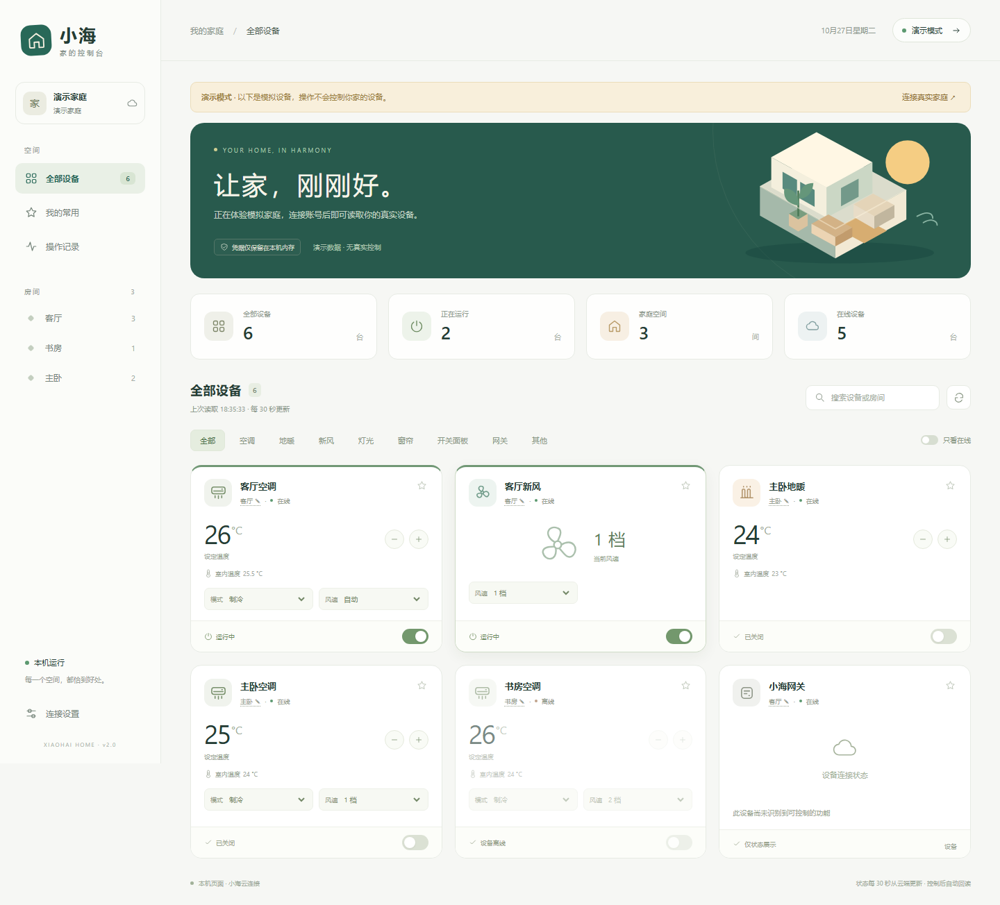

# 小海 · 家的控制台

在电脑上连接小海智家云端，查看和控制灯光、窗帘、开关面板、空调、地暖和新风。

页面和服务运行在本机 `127.0.0.1`，不依赖 Home Assistant、巴法云或家庭网络端口映射。本项目是社区工具，不是厂商官方客户端。

## 功能

- 灯光：每路独立开关、百分比亮度，按设备声明的数值范围换算。
- 窗帘：打开、停止、关闭、目标位置；尊重设备支持的调节步长。
- 多路面板：按通道控制，区分普通开关与场景按键，展示云端返回的自定义通道名称。
- 冷暖与新风：电源、温度、运行模式、风速，依据设备功能定义开放控件。
- 设备分组：云端房间、按设备名称自动归类、按账号保存的本地房间调整。
- 常用设备、搜索、类型和在线状态筛选，适配桌面与窄屏窗口。
- 登录后后台发现设备并展示进度。设备缓存、通道名称和房间配置按账号隔离。
- 操作后回读云端状态，区分已发送、已确认和结果未确认；场景请求不使用相同的旧状态来冒充执行确认。
- 未识别的设备和只读功能仅展示状态，不提供任意功能点写入。



## 环境

Python 3.12 或更高版本。Windows 可使用启动脚本；其他系统可直接运行 Python 服务。

```powershell
python -m venv .venv
.\.venv\Scripts\python.exe -m pip install -r requirements.txt
```

Linux / macOS：

```sh
python3 -m venv .venv
.venv/bin/python -m pip install -r requirements.txt
```

## 云端客户端配置

真实账号登录还需要与目标服务匹配、且你有权使用的客户端协议参数。公开代码不附带厂商的客户端签名密钥；只体验页面可直接使用演示模式。

将 `cloud-client.example.json` 复制到 `.local-data/cloud-client.json`，填写客户端标识、签名参数、版本及 User-Agent。请从你有权使用的客户端配置中取得这些值。

Windows PowerShell：

```powershell
New-Item -ItemType Directory -Path .local-data -Force
Copy-Item -LiteralPath cloud-client.example.json -Destination .local-data/cloud-client.json
```

配置文件不需要账号密码。账号密码在本机页面填写，仅用于当前服务进程的云端登录和会话恢复。

## 启动

Windows 双击 `Start.cmd`，或执行：

```powershell
.\start.ps1 -OpenBrowser
```

其他系统或开发模式：

```sh
python server.py --port 8766
```

打开 <http://127.0.0.1:8766/>。可先选择“先看看演示”，再连接真实账号。

Windows 使用 `Stop.cmd` 或 `.\stop.ps1` 停止。退出账号、停止进程，或者会话超过 12 小时未使用，将结束内存中的登录会话。重启后设备缓存仍在，但需要重新登录。

端口冲突时可执行 `.\start.ps1 -Port 8767 -OpenBrowser`；停止时使用相同端口。

## 数据保存

| 数据 | 位置 / 行为 |
| --- | --- |
| 小海账号密码、云端会话 ID | 仅在 Python 服务内存中使用，不写入文件，不返回页面 |
| 客户端协议配置 | `.local-data/cloud-client.json`，由使用者在本机配置 |
| 设备、通道名称与功能缓存 | `.local-data/accounts/<账号摘要>.json` |
| 手动房间分配 | `.local-data/accounts/<账号摘要>.rooms.json` |
| 常用设备 | 浏览器本地存储，按账号摘要隔离 |
| 进程与诊断日志 | `.runtime/`，仅记录接口名、耗时、错误码等诊断信息 |

缓存采用字段白名单，不保存设备通信密钥。浏览器页面不加载外部脚本、字体或统计服务。`.local-data/`、`.runtime/` 和测试截图目录已加入 Git 忽略规则。

房间名称可能来自云端，也可能根据设备名称推断。点击卡片上的房间名称可在本机修改；修改优先于自动归类，并在刷新后保留。场景名称未返回时显示按键编号，不依据名称排列顺序猜测绑定关系。

## 测试

后端测试使用标准库 `unittest` 和本地模拟云端，不需要真实账号：

```sh
python -m unittest discover -s tests -v
node --check static/app.js
```

浏览器检查另需 Playwright：

```sh
python -m pip install -r requirements-dev.txt
python -m playwright install chromium
python tests/browser_check.py
python tests/browser_loading_check.py
python tests/browser_devices_check.py
```

浏览器检查需要本机服务已启动，只操作演示设备或拦截后的模拟接口。示例设备使用合成标识，不包含真实账号、设备 ID、会话或密钥。

## 代码结构

| 文件 / 目录 | 职责 |
| --- | --- |
| `cloudio/wire.py` | 本机协议配置、请求编码与签名 |
| `cloudio/client.py` | 账号会话、云端资源读取和命令发送 |
| `device_schema.py` | 功能定义、房间关系、版本与在线状态解析 |
| `environment_controls.py` | 空调、地暖、新风的能力和参数校验 |
| `extended_devices.py` | 灯光、多路开关、场景、窗帘与网关能力 |
| `devices.py` | 面向页面的设备视图、发现流程和演示数据 |
| `channel_metadata.py` / `rooms.py` | 自定义通道名和房间归类 |
| `local_store.py` | 按账号隔离的本地缓存 |
| `server.py` / `static/` | 本机 HTTP 服务与控制页面 |

接口字段和兼容范围见 [PROTOCOL.md](PROTOCOL.md)。

## License

本项目代码采用 [MIT License](LICENSE)。许可证适用于仓库中的软件代码；不授予第三方商标、云服务、账号或客户端凭据的使用权。
